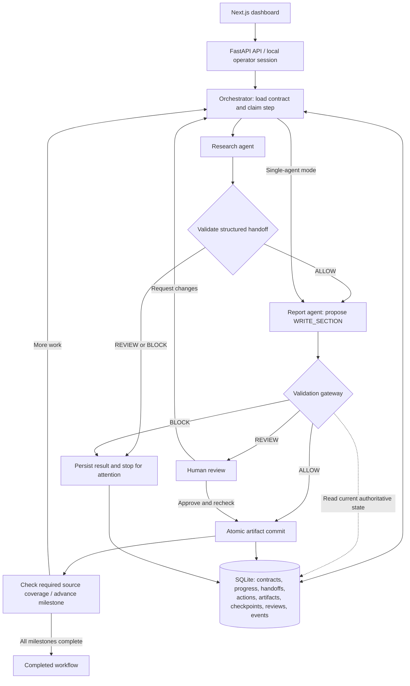

# Tether

**Persistent goal enforcement across AI sessions and agent handoffs.**

Tether is a local application that turns a user's goal into a versioned contract, gives agents bounded work, and checks their proposals before saving output. It combines a Next.js dashboard, FastAPI API, Python enforcement engine, and SQLite persistence.

**Agents propose. Tether validates. Only authorized work is saved.**

## Why Tether exists

An agent can lose track of scope as conversations grow, sessions restart, or work moves between specialists. Repeating instructions in prompts does not provide an application-level write boundary. Tether stores approved scope outside the model and checks proposed changes against that state at commit time.

The current prototype demonstrates this through a synthetic cloud-comparison workflow and a general drafting mode. Its implemented control boundary is report-section writes; it is not a universal sandbox for arbitrary agent tools or a complete semantic drift detector.

## Contents

- [Architecture](#architecture)
- [Goal contracts](#goal-contracts)
- [Agent coordination and shared state](#agent-coordination-and-shared-state)
- [Validation gateway](#validation-gateway)
- [Goal evolution and milestone progression](#goal-evolution-and-milestone-progression)
- [Persistence, recovery, and concurrency](#persistence-recovery-and-concurrency)
- [Run the application](#run-the-application)
- [Provider configuration](#provider-configuration)
- [Product workflow](#product-workflow)
- [API overview](#api-overview)
- [Repository map](#repository-map)
- [Existing data](#existing-data)
- [Tests](#tests)
- [Engine tools and contracts](#engine-tools-and-contracts)
- [Measured proposal evaluation](#measured-proposal-evaluation)
- [Limitations and future work](#limitations-and-future-work)
- [Troubleshooting](#troubleshooting)
- [Further documentation](#further-documentation)

## Architecture



The validation gateway is a logical boundary implemented by Python functions and the store's commit path, not a separately deployed service. In general drafting mode, a draft agent replaces the research/report evidence flow and every valid proposal requires human review.

| Component | Responsibility |
|---|---|
| Next.js / React / TypeScript frontend | Create projects, inspect proposals and sources, approve or reject work, inspect history and evaluation |
| FastAPI backend | Own project/session identities, local operator decisions, execution claims, and background workflows |
| Python engine | Structured proposals, deterministic validation, goal evolution, reviews, and checkpoint restoration |
| SQLite | Authoritative approved contracts and durable execution state |
| Groq / Ollama clients | Generate structured model output; neither provider grants authorization |

The frontend proxies `/api/*` to FastAPI. The backend chooses a single-agent or sequential-specialist runner. Both specialist roles use the configured inference provider; separate roles do not imply separate model weights.

## Goal contracts

A `GoalContract` is the machine-readable approved scope for a project, defined in [engine/schemas.py](engine/schemas.py). It contains:

| Field | Purpose |
|---|---|
| `project_id` | Bind the contract to its project |
| `version` | Identify the approved scope revision |
| `objective` | Describe the requested outcome |
| `constraints` | Declare hard restrictions, such as supplied-fixture-only evidence |
| `approved_topics` | Enumerate authorized topics |
| `milestones` | Define stages, allowed topics, and initial execution status |

The cloud template in [scenarios/cloud_comparison.json](scenarios/cloud_comparison.json) starts with COST, DEPLOYMENT, COMPARISON, and RECOMMENDATION milestones. SECURITY and SERVERLESS are outside its initial scope. The supplied references in [scenarios/cloud_snapshot.json](scenarios/cloud_snapshot.json) are explicitly synthetic.

The contract is stored as JSON in SQLite's `contracts` table under `(project, version)`. The default product database is `backend/data/tether.sqlite3`; `TETHER_DB` can override it. `shared/contracts/GoalContract.schema.json` is the exported wire schema, not a project's live contract.

Shared models reject unknown fields and use Pydantic's frozen configuration. Contract validation rejects duplicate constraint/milestone IDs and milestone topics outside the approved topics. Approved snapshots are append-only through the application APIs; this is application-level history preservation, not cryptographic tamper protection against someone editing the database directly.

**Declared policy and implemented enforcement are distinct.** The current validator implements fixture-specific authorization and evidence rules. It does not compile arbitrary constraint text or the objective into a general policy language.

## Agent coordination and shared state

[engine/orchestrator.py](engine/orchestrator.py) loads `effective_contract(project_id)` before planning a step. This combines the latest approved snapshot with current milestone statuses from `milestone_state`.

In specialist mode:

1. Research receives the contract as JSON, the application-owned identifiers, active milestone/topic, and authorized reference records.
2. Research returns an `AgentHandoff` with findings, reference IDs, provider attribution, unresolved questions, completed-work notes, and a suggested next action.
3. The gateway validates and persists the handoff. A non-ALLOW handoff stops the sequence; uncertain research can be rejected and regenerated rather than treated as approved evidence.
4. Report receives the same loaded contract, the validated handoff, and original reference records selected by the handoff's findings.
5. Report returns an `AgentAction`, not an executed write. The orchestrator checks its identity and milestone/topic binding against the handoff.
6. The store reloads current authorization and validates before committing.

The agents share an authoritative database-backed contract through explicit inputs. They do not edit a shared contract, negotiate authorization, or depend on shared conversation memory. There is no vector memory store or peer-to-peer agent messaging layer.

`AgentAction` binds `action_id`, `project_id`, `session_id`, `contract_version`, `milestone_id`, and `topic`. It declares section changes, introduced topics, references, numerical claims, section content, and a rationale. The supported action type is currently `WRITE_SECTION`.

General drafting uses a smaller `DraftResponse`; application code wraps it in an `AgentAction`. The model receives the objective and revision feedback rather than the entire contract. Drafts cannot claim verified source evidence and must contain `UNVERIFIED_DRAFT`.

### Orchestrator checks versus gateway checks

| Orchestrator | Validation gateway and commit path |
|---|---|
| Selects the next agent and active work | Decides whether proposed output is authorized |
| Checks session/project binding and saved action replay | Checks current contract version, scope, milestone, evidence, and actual section effects |
| Rejects model changes to application-owned IDs | Rechecks mandatory rules under the database write transaction |
| Keeps Report bound to the validated handoff | Returns ALLOW, REVIEW, or BLOCK and controls artifact persistence |

Identity checks overlap intentionally. A proposal can become stale while inference is running, so early checks do not replace commit-time checks.

## Validation gateway

The gateway uses deterministic Python checks in [engine/validator.py](engine/validator.py), [engine/handoff.py](engine/handoff.py), and the store/review layer. It does not ask an LLM to approve another LLM's work.

| Decision | Behavior |
|---|---|
| `ALLOW` | Persist the proposal and commit its section automatically |
| `REVIEW` | Persist the proposal and reasons without writing the artifact; require human judgment |
| `BLOCK` | Persist the proposal and reasons without writing the artifact; mandatory violations cannot be overridden through review |

Action checks include:

- Matching project/session and current approved contract version.
- An active milestone and a topic approved for both the milestone and project.
- Declared topics matching the action topic; declared section creation/modification matching the actual write.
- Prevention of overwriting a section owned by another milestone.
- Known source IDs and source topics authorized for the action.
- Numerical claims tied to supplied values and source quotations present in output; no undeclared numerical content after source IDs are removed.
- Required `SYNTHETIC_DEMONSTRATION` labeling and no external URLs in fixture-based artifacts.
- Selected keyword rules for unauthorized security and serverless content.
- Human review for missing visible citations, free-form claims, comparisons, and recommendations.

The narrow automatic path consists of exact fixture quotations, source identifiers, and the synthetic label. Arbitrary paraphrases or synthesized prose require review. General drafts always require review after mandatory checks pass.

Handoff checks include project/session/version, active milestone, authorized topic, unique finding IDs, known references, matching providers, exact source summaries, and unresolved questions. Non-exact summaries and unresolved questions require attention rather than silently becoming trusted evidence.

Human approval requires an explanation of at least 10 characters. Before saving, it rechecks mandatory rules and verifies that the target section has not changed since the proposal. The original gateway REVIEW decision remains in history alongside a separate human approval event. Rejections and requested revisions retain previous proposals.

These checks establish bounded authorization and evidence consistency. They do not establish that arbitrary prose is true, that an objective has been semantically satisfied, or that synthetic fixture facts reflect the real world.

## Goal evolution and milestone progression

Scope expansion is explicit. A `GoalChange` identifies the project, base contract version, new topics, new pending milestones, and rationale. Trusted approval creates the next contract version while preserving earlier snapshots.

The current evolution API is additive: it cannot replace existing milestones, remove restrictions, or rewrite the objective. New milestone topics must exactly cover the requested new topics. Base-version checks are repeated inside the approval transaction so competing stale changes cannot overwrite approved scope.

For example, **Add serverless comparison → Approve change** produces v2 with the serverless topic and M5. Agents cannot approve this change themselves.

Execution status is stored separately from immutable approved snapshots. Completing a milestone marks it COMPLETED and activates the next pending milestone. The automatic workflow checks that the committed artifact declares every required authorized reference before advancing. The lower-level engine completion method requires a committed supporting artifact but does not itself implement the automatic workflow's full source-coverage check.

## Persistence, recovery, and concurrency

| Durable data | Purpose |
|---|---|
| `contracts`, `changes` | Approved versions and goal-change decisions |
| `sessions`, `checkpoints` | Session binding and resumable execution state |
| `milestone_state` | Current milestone progress |
| `handoffs` | Research output and gateway decisions |
| `actions`, `action_bases`, `action_reviews` | Proposals, target revision checks, and human decisions |
| `artifacts` | Currently committed report sections |
| `events` | Ordered audit timeline |
| `evaluation_runs` | Recorded proposal evaluation summaries |
| `app_*` tables | Dashboard metadata, execution claims, and workflow state |

`commit_action()` revalidates inside `BEGIN IMMEDIATE` and atomically persists the proposal/result, permitted artifact write, checkpoint, and audit event. REVIEW/BLOCK never write the final artifact.

Action keys are idempotent. A completed key replays its saved result without another model call or duplicate commit. Reusing a key with different action content fails. Replays return the historical outcome; they do not authorize a new write against today's contract. Saved handoffs are revalidated before reuse.

Checkpoint restoration loads the current contract, artifacts, and persisted handoffs without needing the original chat transcript. Closing the browser does not terminate the backend workflow. A backend restart marks interrupted work for attention and pauses running workflows; resume continues from saved state.

Execution is claimed before network inference, and the database write transaction is not held open during a model call. Use one backend worker. FastAPI background tasks and SQLite persistence are a local workflow implementation, not a distributed durable task queue.

The local API grants an HttpOnly, same-site operator cookie through `/api/health`; POST requests require that cookie and an allowed Origin. Approval actors come from trusted backend code, not agent output or client JSON. This is a loopback operator model, not production multi-user authentication or role-based access control.

## Run the application

Python 3.12+ and Node.js 20.9+ are required. Copy `.env.example` to `.env` and configure a provider. For local-only inference, set `TETHER_PROVIDER=ollama`, start Ollama, and pull `qwen3:4b`.

### macOS / Linux

From the repository root:

```sh
python3 -m venv .venv
source .venv/bin/activate
python -m pip install -e ".[dev]" -r backend/requirements.txt
cp .env.example .env
# Edit .env before starting the backend.
python -m uvicorn backend.main:app --host 127.0.0.1 --port 8000
```

In another terminal:

```sh
cd frontend
npm ci
npm run dev
```

### Windows PowerShell

From the repository root, copy `.env.example` to `.env` if you have not already done so, then configure it:

```powershell
python -m venv .venv
.\.venv\Scripts\python.exe -m pip install -e ".[dev]" -r backend/requirements.txt
.\.venv\Scripts\python.exe -m uvicorn backend.main:app --host 127.0.0.1 --port 8000
```

In another terminal:

```powershell
cd frontend
npm ci
npm run dev
```

Open http://127.0.0.1:3000. API docs: http://127.0.0.1:8000/docs. Use a single backend worker; SQLite step claims serialize local execution. Backend grants a same-site HttpOnly local operator cookie on GET /api/health; mutations require that cookie and a trusted local Origin. Refresh the dashboard after restarting the backend. Agent output and arbitrary JSON cannot supply an approval actor.

## Provider configuration

FastAPI loads backend/.env and then the ignored root .env file. Explicit shell/service variables take precedence, then backend/.env, then root .env. The standalone engine CLI loads root .env. Restart FastAPI after editing credentials; .env.example contains placeholders only. Credentials never belong in NEXT_PUBLIC variables, tracked files or persisted events. Use a Groq Free plan account without enabling paid billing.

- TETHER_PROVIDER=groq (default): hosted primary with eligible-failure Ollama backup.
- TETHER_PROVIDER=groq-only: no fallback, for honest provider-only measurements.
- TETHER_PROVIDER=ollama: explicit offline mode.
- GROQ_API_KEY, GROQ_MODEL=openai/gpt-oss-20b, GROQ_TIMEOUT_SECONDS=15.
- OLLAMA_BASE_URL=http://127.0.0.1:11434, OLLAMA_MODEL=qwen3:4b.
- TETHER_DB=backend/data/tether.sqlite3; TETHER_API_URL optionally changes the frontend proxy target.

Start Ollama and run `ollama pull qwen3:4b` for local inference. The hosted timeout is an HTTP I/O timeout, not a total deadline. Inference outages/eligible rate limits can fall back; policy BLOCK/REVIEW never switches providers. Malformed hosted requests and refusals fail visibly. Both providers use the same engine gateway.

Hosted report requests send the objective, constraints, synthetic fixture and validation feedback to Groq. Specialist requests additionally contain research/handoff material; the UI uses the configured provider for both sequential specialists. Durable state stays in SQLite. Inference events contain only allowlisted provider/model/agent/timing/fallback fields, never raw prompts or credentials. Historical actions retain their original attribution.

## Product workflow

1. Click **New project** and choose **Your request** for a concise general AI draft, or **Cloud comparison** for the guided synthetic evidence demo. General requests use one agent and one response per proposal; they do not browse or verify current information. Cloud comparisons retain the existing Research + Report or single-agent workflow.
2. **Create & start workflow** creates the project and starts a persisted backend sequence. Research → validated handoff → report → validation → commit → milestone progression runs without repeated next-step clicks. Closing the browser does not stop execution.
3. Exact quotations can commit automatically. Milestones advance only when the committed artifact covers every required source. Comparison/recommendation always require substantive human REVIEW, even if the model returns quotations alone. Review sources and enter an explanation to approve; approval resumes the sequence automatically. BLOCK cannot be overridden. Rejection preserves history; resume requests a new proposal.
4. In **Action review**, the validation reason and agent rationale explain why a proposal needs attention. Enter an explanation to approve, reject, or **Request changes**. Request changes generates a new proposal using your feedback and preserves the rejected version.
5. **Pause after current step** allows an in-flight proposal to finish, then stops further work. **Resume workflow** resumes saved progress and failed action keys; it does not repeat completed commits. Incomplete evidence pauses explicitly and can be regenerated on resume.
6. Scope expansion remains explicit: **Add serverless comparison → Approve change** creates immutable v2/M5. Start/resume a workflow to perform the newly approved work.
7. Restarting FastAPI pauses an interrupted workflow; resume once to continue from persisted artifacts and handoffs. Existing manual step/session APIs remain available for diagnostics.

Both agents use `TETHER_PROVIDER`: Groq primary/Ollama backup by default, `groq-only` for hosted-only execution, or `ollama` for offline inference. Groq rate limits with a valid `Retry-After` of at most 45 seconds receive one automatic retry before eligible fallback; longer waits fail/fall back visibly. Provider waiting is shown in the workflow message and audit timeline. There is no unbounded retry loop or policy-triggered fallback. Hosted calls are serialized within the API worker. After a terminal 429, new clients share a cooldown for the provider’s Retry-After interval (60 seconds when absent), failing over or reporting the limit without another hosted request. This reduces repeated requests; it does not increase provider quotas. Cooldowns reset on backend restart. Run one API worker.

Evaluation reads persisted proposal-level baseline/Tether runs; it stays empty until the evaluation CLI records actual calls. SYNTHETIC_DEMONSTRATION fixture values are invented, not current cloud prices or deployment measurements. The supplied deployment descriptions do not establish a simplicity ranking; recommendations must state this evidence limitation.

## API overview

Interactive request/response schemas are available at `http://127.0.0.1:8000/docs` while the backend runs. The frontend normally manages the operator cookie and Origin for mutations.

| Method and route | Purpose |
|---|---|
| `GET /api/health` | Health/provider information and local operator cookie |
| `GET /api/projects`, `POST /api/projects` | List or create projects |
| `GET /api/projects/{project}` | Project state |
| `GET /api/projects/{project}/contracts` | Approved contract history |
| `POST /api/projects/{project}/workflow` | Start or resume automatic work |
| `POST /api/projects/{project}/workflow/pause` | Pause after the in-flight step |
| `POST /api/projects/{project}/sessions` | Create a manual diagnostic session |
| `GET /api/sessions/{session}` | Session and restored checkpoint |
| `POST /api/sessions/{session}/step` | Execute one proposal step |
| `GET /api/sessions/{session}/handoffs` | Inspect persisted handoffs |
| `POST /api/sessions/{session}/pending/decision` | Reject pending research |
| `POST /api/actions/{action}/decision` | Approve or reject a REVIEW proposal |
| `POST /api/actions/{action}/revise` | Request a revised proposal |
| `POST /api/projects/{project}/changes` | Propose scope expansion |
| `POST /api/changes/{change}/decision` | Approve or reject a goal change |
| `POST /api/projects/{project}/milestones/{milestone}/complete` | Explicit milestone completion |
| `GET /api/projects/{project}/references` | Inspect supplied evidence |
| `GET /api/projects/{project}/report` | Read committed sections |
| `GET /api/projects/{project}/timeline` | Read audit events |
| `GET /api/projects/{project}/metrics` | Read persisted evaluation summaries |
| `POST /api/projects/{project}/recover` | Restore saved project/session context |
| `POST /api/demo/reset` | Create a fresh demo while preserving history |
| `GET /api/projects/{project}/archive` | Inspect migrated legacy data |
| `GET /api/demo/safety-examples` | Inspect demonstration validation cases |

## Repository map

```text
backend/                 FastAPI API, configuration, provider integration, app store
engine/
  schemas.py             Strict typed wire models
  orchestrator.py        Single-agent and sequential specialist execution
  research_agent.py      Fixture research and structured handoff generation
  report_agent.py        Evidence-based section proposal generation
  draft_agent.py         General unverified drafting
  validator.py           Action authorization and evidence checks
  handoff.py             Research handoff checks
  executor.py            SQLite commit boundary, events, and checkpoints
  state.py               Effective contracts, milestones, handoff persistence
  goal_evolution.py      Additive versioned scope changes
  review.py              Human resolution and target revision checks
  llm_client.py          Structured inference, retries, and provider fallback
  evaluator.py           Proposal evaluation and independent grading rules
frontend/                Next.js dashboard, API client, and typed view models
scenarios/               Initial cloud contract and synthetic source snapshot
shared/contracts/        Exported JSON Schemas
scripts/                 CLI runs, benchmarks, evaluation, schema export
tests/                  Engine, lifecycle, backend, workflow, and inference tests
docs/                   Design notes, walkthroughs, and verification records
runtime/                 Ignored CLI/evaluation outputs
```

## Existing data

Opening an old full-stack database creates a `.pre-engine.sqlite3` backup, archives its tables as legacy_*, and imports its approved goal history/project/session metadata. Previous actions/reports remain available at GET /api/projects/{id}/archive. They are not silently recommitted against the new fixture and validators. Initial execution status is re-established; the original snapshots remain in the archive. No reset or deletion is performed.

## Tests

```powershell
python -m pytest -q --basetemp=backend/data/pytest-run
cd frontend
npm run typecheck
npm run build
```

Tests use isolated SQLite databases and scripted HTTP/model doubles. They do not claim live model quality or baseline improvements. See docs/INITIAL_RESULTS.md for the partner's historical measurements.

## Engine tools and contracts

```powershell
python -m scripts.run_slice --provider ollama --action A-NEW
python -m scripts.run_slice --mode specialists --provider ollama --action A-SPECIALISTS
python -m scripts.benchmark --provider groq-only
python -m scripts.export_schemas
```

CLI defaults to TETHER_DB or runtime/tether.sqlite3. Runtime outputs are ignored by Git. The CLI may save raw inference request/response artifacts locally; the product timeline does not.

- shared/INTEGRATION.md and shared/contracts/: engine wire contracts.
- docs/TEAMMATE_UPDATE.md: provider-routing agreement.
- docs/LIFECYCLE_UPDATE.md: goal evolution, milestones and handoffs.
- backend/store.py: product metadata, safe legacy migration and engine Store adapter.
- frontend/: three-tab dashboard and typed API view models.

The Fresh demo control starts a clean project and retains the original project/history. Remaining: comprehensive semantic drift classification and a full multi-session independent evaluation suite (the current runner evaluates individual proposals), broader charts and presentation polish. No fabricated success or performance metrics.


## Measured proposal evaluation

Use an existing project ID and the same database as the backend. The runner tests
clean and drift-note inputs in baseline and Tether modes with identical planner
inputs/budget. Baseline commits are simulated in evaluation output only; they never
write to the product report. Actual model responses and raw settings are saved
under `runtime/evaluations/`. The dashboard reads persisted summaries after refresh.

```sh
PYTHONPATH=. .venv/bin/python scripts/evaluate.py --db backend/data/tether.sqlite3 \
  --project YOUR_PROJECT_ID --provider ollama --repeats 1
```

Use `--provider groq-only` for an authorized hosted benchmark with a configured key.
Automatic provider fallback is disabled for comparisons. Arbitrary prose is graded
UNVERIFIED rather than assumed correct. Unauthorized rate is N/A when nothing
commits. These are proposal simulations, not a completed four-session benchmark.

See [pull verification and changes](docs/PULL_VERIFICATION.md) for current findings.

See [automatic workflow verification](docs/AUTOMATIC_WORKFLOW.md) for the current UX and validation evidence.

## Limitations and future work

- Enforcement currently covers structured report-section writes. There are no general shell, browser, payment, or deployment tool adapters behind this boundary.
- Cloud research uses invented fixture data. There is no live browsing or independent verification of current prices. Deployment descriptions do not establish a measured simplicity ranking.
- Scope keyword rules and quotation matching are conservative examples, not complete semantic understanding. Unknown reasoning quality is sent to human review.
- Contract constraints are typed declarations; enforcement is implemented in domain-specific code. New domains need explicit policies, evidence adapters, and checks.
- General drafting receives the objective and revision feedback, has no verified evidence, and requires human review. It does not exercise the full specialist contract-sharing path.
- Persistence is local SQLite with a single API worker. Background execution is not a distributed scheduler, and restarts require explicit resume.
- Local operator cookies are not production account authentication, tenant isolation, or role-based authorization. Audit history is not cryptographically tamper-evident.
- Evaluation compares individual proposals under clean/drift-note inputs. It does not establish long-horizon multi-session performance, general factual correctness, or a universal reduction in goal drift.

Future work includes broader semantic drift classification, domain-specific policy adapters, controlled tool execution, a full independent multi-session evaluation suite, stronger deployment/authentication infrastructure, and expanded evaluation visualization. These are planned extensions rather than implemented guarantees.

## Troubleshooting

| Symptom | Check |
|---|---|
| Frontend cannot reach backend | Run FastAPI on port 8000, or set `TETHER_API_URL` before starting Next.js |
| Mutation returns 403 after backend restart | Refresh the workspace so `/api/health` grants the new operator cookie; use a supported loopback Origin |
| Groq credentials changed but requests still fail | Restart FastAPI and check environment precedence; do not expose keys in frontend variables |
| Ollama fallback cannot connect | Start Ollama, pull `qwen3:4b`, and verify `OLLAMA_BASE_URL` and `OLLAMA_MODEL` |
| Provider is waiting or rate-limited | Inspect the workflow message/timeline; bounded retry and cooldown apply, and fallback needs working Ollama |
| Workflow stopped at REVIEW | Inspect proposed content and sources, then approve with an explanation, reject, or request changes |
| Proposal is BLOCKED | Inspect mandatory validation reasons; approval cannot override them, so generate corrected work or explicitly approve a valid scope change |
| Workflow paused after restart | Resume from the dashboard; saved contracts, artifacts, and handoffs remain available |
| Evaluation is empty | Run the evaluation CLI against the same database and a cloud project with an active milestone |
| Source coverage is incomplete | Resume the NEEDS_EVIDENCE workflow to regenerate the milestone with all required sources |

## Further documentation

- [Automatic workflow verification](docs/AUTOMATIC_WORKFLOW.md): persisted execution and review behavior.
- [Lifecycle update](docs/LIFECYCLE_UPDATE.md): contracts, milestones, and handoffs.
- [Engine integration](shared/INTEGRATION.md): adapter and wire-contract details; includes historical notes and subsequent updates.
- [Provider integration](docs/TEAMMATE_UPDATE.md): routing and provider agreement.
- [Demo walkthrough](docs/DEMO_WALKTHROUGH.md) and [hackathon demo](docs/HACKATHON_DEMO.md): demonstration material.
- [Pull verification](docs/PULL_VERIFICATION.md), [merge verification](docs/MERGE_VERIFICATION.md), and [run-step verification](docs/RUN_STEP_VERIFICATION.md): recorded checks and their limits.
- [Initial results](docs/INITIAL_RESULTS.md): historical measurements; these should not be interpreted as new measurements of the current implementation.

The source code defines current behavior. Some supporting documents describe earlier implementation stages; read their later updates and verification context alongside the code.
